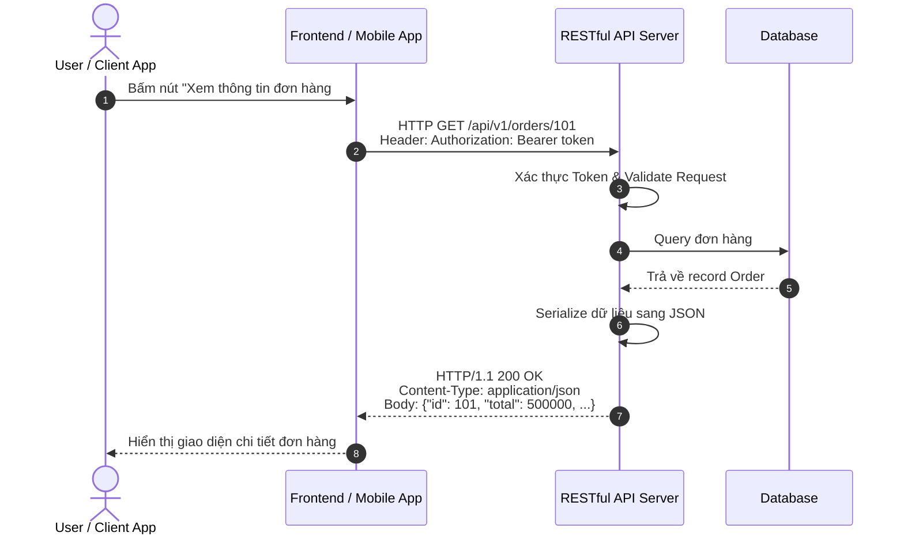

# CHUYÊN ĐỀ 1: TỔNG QUAN VỀ API & KIẾN TRÚC RESTful API

Tài liệu này bao quát toàn bộ nội dung của phần **Outline 1** theo chuẩn đào tạo kỹ thuật:
1. What is API?
2. What is REST, RESTful API?
3. How does REST work?
4. REST constraints (6 ràng buộc kiến trúc REST)
5. Advantages & Defects of REST, RESTful API

---

## 1. What is API? (API là gì?)

### 1.1. Định nghĩa
**API** viết tắt của **Application Programming Interface** (Giao diện lập trình ứng dụng). 
Đây là tập hợp các quy tắc, giao thức và công cụ cho phép các chương trình, phần mềm hoặc dịch vụ khác nhau có thể **giao tiếp và trao đổi dữ liệu** với nhau một cách an toàn và chuẩn hóa.

```
+--------------------+                     +--------------------+
|   Client / Ứng dụng | ---- Request -----> |   Server / Hệ thống|
| (Mobile, Web, App) | <--- Response ----- | (Database, Service)|
+--------------------+        (API)        +--------------------+
```

### 1.2. Ví dụ trực quan trong đời sống
- **Người phục vụ tại nhà hàng:** Khách hàng (Client) gọi món từ thực đơn -> Người phục vụ (API) chuyển yêu cầu tới nhà bếp (Server/Database) -> Nhà bếp nấu món ăn -> Người phục vụ mang món ăn ra cho khách (Response).
- Khách hàng không cần biết bên trong nhà bếp vận hành ra sao, chỉ cần tương tác qua người phục vụ với thực đơn đã quy ước trước.

### 1.3. Vai trò của API trong kiến trúc hiện đại
1. **Trừu tượng hóa & Bảo mật:** Che giấu logic nghiệp vụ nội bộ và bảo vệ trực tiếp Cơ sở dữ liệu (Database). Không ai cho phép Client kết nối trực tiếp vào Database trên production.
2. **Kiến trúc tách rời (Decoupled Architecture):** Cho phép Frontend (React, Vue, Flutter, iOS, Android) và Backend phát triển độc lập, kết nối với nhau qua API chuẩn.
3. **Kiến trúc Microservices:** Chia nhỏ hệ thống lớn thành nhiều dịch vụ độc lập (Auth Service, Order Service, Payment Service), giao tiếp với nhau qua API nội bộ.
4. **Tích hợp bên thứ ba (Third-party Integration):** Tích hợp cổng thanh toán (VNPay, Momo, Stripe), bản đồ (Google Maps), mạng xã hội (Facebook, Google Login), thời tiết,...

---

## 2. What is REST, RESTful API?

### 2.1. REST là gì?
- **REST** là viết tắt của **Representational State Transfer** (Chuyển giao trạng thái đại diện).
- Do tiến sĩ **Roy Fielding** đề xuất vào năm 2000 trong luận án tiến sĩ của ông tại Đại học California, Irvine.
- **Lưu ý quan trọng:** REST **không phải là giao thức (protocol)** như HTTP, FTP, hay SOAP. REST là một **phong cách kiến trúc (Architectural Style)** đưa ra các quy tắc và hướng dẫn để thiết kế các hệ thống nối mạng (networked applications).

### 2.2. RESTful API là gì?
- **RESTful API** là API được thiết kế tuân thủ nghiêm ngặt các nguyên lý và ràng buộc kiến trúc của REST.
- Hầu hết các RESTful API hiện đại sử dụng:
  - Giao thức nền tảng: **HTTP / HTTPS**.
  - Định dạng dữ liệu đại diện: **JSON** (phổ biến nhất) hoặc **XML**.
  - Định danh thực thể: **URI** (Uniform Resource Identifier).

### 2.3. Khái niệm cốt lõi: Resource (Tài nguyên)
Trong REST, mọi thứ đều xoay quanh **Resource** (Tài nguyên):
- Một tài nguyên có thể là bất cứ đối tượng thông tin nào: `User`, `Order`, `Product`, `Comment`, `Invoice`.
- Mỗi tài nguyên được định danh duy nhất bởi một URI: `/users/12`, `/products/99`.
- **Representation (Biểu diễn):** Dữ liệu của tài nguyên tại một thời điểm được serialize thành định dạng trao đổi, phổ biến là JSON:
  ```json
  {
    "id": 12,
    "name": "Nguyen Van A",
    "email": "vana@example.com",
    "status": "active"
  }
  ```

---

## 3. How does REST work? (REST hoạt động như thế nào?)

REST hoạt động dựa trên mô hình **Client - Server Request/Response** phi trạng thái (Stateless) trên nền giao thức HTTP:



### Các bước xử lý cơ bản:
1. **Client gửi HTTP Request:** Chứa Method (`GET`, `POST`, `PUT`, `DELETE`), URI tài nguyên, Headers (Xác thực, định dạng) và Body (nếu có).
2. **Server định tuyến (Routing):** Điều hướng request tới Controller tương ứng.
3. **Thực thi nghiệp vụ:** Kiểm tra quyền (Authorization), truy vấn Database hoặc dịch vụ nội bộ.
4. **Server phản hồi HTTP Response:** Gửi về HTTP Status Code (200, 201, 404, 500,...), Headers kèm dữ liệu đã serialize (thường là JSON).

---

## 4. REST Constraints (6 Ràng buộc kiến trúc cốt lõi)

Để một hệ thống được coi là chuẩn REST (RESTful), nó phải thỏa mãn **6 ràng buộc (constraints)** sau:

```
                  +--------------------------------+
                  |    6 RÀNG BUỘC KIẾN TRÚC REST   |
                  +--------------------------------+
                                  |
    +-------------------+---------+---------+-------------------+
    |                   |                   |                   |
1. Client-Server   2. Stateless      3. Cacheable       4. Layered System
    |                   |
5. Uniform Interface    6. Code on Demand (Optional)
```

### 4.1. Client-Server Architecture (Kiến trúc Client - Server)
- Tách bạch hoàn toàn giữa **giao diện người dùng (Client)** và **lưu trữ dữ liệu/xử lý nghiệp vụ (Server)**.
- **Lợi ích:** Frontend có thể đổi từ Web sang Mobile App, hoặc đổi công nghệ (React sang Vue) mà Backend không cần thay đổi.

### 4.2. Statelessness (Phi trạng thái)
- **Quy tắc:** Server **không lưu trữ bất kỳ trạng thái nào (session state)** của Client giữa các request.
- Mỗi request gửi từ Client lên Server phải chứa đầy đủ mọi thông tin cần thiết để Server hiểu và xử lý (ví dụ: Token xác thực, tham số truy vấn).
- **Lợi ích:**
  - Dễ dàng mở rộng ngang (Horizontal Scaling): Bất kỳ máy chủ nào trong cụm Load Balancer cũng có thể phục vụ request.
  - Đơn giản hóa việc bảo trì và phục hồi khi server gặp sự cố.

### 4.3. Cacheability (Khả năng lưu bộ nhớ đệm)
- Mọi phản hồi (Response) từ Server phải tự định nghĩa rõ ràng nó **có thể cache được hay không (Cacheable or Non-cacheable)**.
- Thông qua các HTTP Header như `Cache-Control`, `Expires`, `ETag`.
- **Lợi ích:** Giảm tải cho Server, tiết kiệm băng thông và tăng tốc độ phản hồi cho người dùng đối với các tài nguyên ít biến động.

### 4.4. Layered System (Hệ thống phân tầng)
- Client không thể biết (và không cần quan tâm) liệu mình đang kết nối trực tiếp đến Server đích hay qua các lớp trung gian (Proxy, Reverse Proxy, Load Balancer, Gateway, CDN).
- **Lợi ích:** Cho phép thêm các tầng bảo mật (WAF), cân bằng tải, hoặc lưu bộ nhớ đệm mà không ảnh hưởng đến Client.

### 4.5. Uniform Interface (Giao diện đồng nhất)
Đây là ràng buộc quan trọng nhất tạo nên sự khác biệt của REST. Ràng buộc này gồm 4 nguyên tắc con:
1. **Identification of resources (Định danh tài nguyên):** Tài nguyên được định danh độc lập thông qua URI (ví dụ: `/users/1`).
2. **Manipulation of resources through representations (Thao tác qua biểu diễn):** Client giữ biểu diễn của tài nguyên (ví dụ JSON) kèm quyền hạn có thể sửa hoặc xóa tài nguyên trên Server.
3. **Self-descriptive messages (Thông điệp tự mô tả):** Mỗi thông điệp mang đủ thông tin chỉ rõ cách xử lý (ví dụ: `Content-Type: application/json` báo cho bên nhận biết dữ liệu là JSON).
4. **HATEOAS (Hypermedia As The Engine Of Application State):** Response nên chứa các đường link dẫn tới các hành động tiếp theo mà Client có thể thực hiện (tương tự như liên kết HTML duyệt web).

### 4.6. Code on Demand (Tùy chọn - Optional)
- Cho phép Server tạm thời mở rộng hoặc tùy biến chức năng của Client bằng cách truyền xuống mã có thể thực thi được (ví dụ: JavaScript applet, mã script).
- Đây là ràng buộc duy nhất mang tính tùy chọn trong kiến trúc REST.

---

## 5. Advantages & Defects of REST, RESTful API (Ưu và Nhược điểm)

### 5.1. Ưu điểm (Advantages)
| Ưu điểm | Giải thích chi tiết |
| :--- | :--- |
| **Đơn giản & Dễ hiểu** | Tận dụng trực tiếp các phương thức và cơ chế sẵn có của giao thức HTTP (`GET`, `POST`, Status Codes), không cần học thêm protocol phức tạp. |
| **Độc lập nền tảng (Platform-Independent)** | Client và Server có thể viết bằng bất kỳ ngôn ngữ nào (JS, Python, Java, Go, Swift) chỉ cần hiểu HTTP và JSON. |
| **Khả năng mở rộng cao (Scalability)** | Nhờ nguyên tắc Stateless, hệ thống dễ dàng đặt sau Load Balancer và scale ngang hàng trăm server. |
| **Hiệu năng cao nhờ Caching** | Hỗ trợ cơ chế cache tự nhiên của HTTP (Browser cache, CDN, Proxy cache). |
| **Dễ dàng kiểm thử & Giám sát** | Có thể dùng trình duyệt, `curl`, hoặc Postman để kiểm thử API một cách nhanh chóng mà không cần client chuyên biệt. |

### 5.2. Nhược điểm & Hạn chế (Defects & Limitations)
| Nhược điểm | Chi tiết & Vấn đề phát sinh |
| :--- | :--- |
| **Over-fetching (Lấy thừa dữ liệu)** | Endpoint trả về toàn bộ trường dữ liệu của đối tượng, dù Client chỉ cần 1-2 trường (gây tốn băng thông trên thiết bị di động). |
| **Under-fetching & N+1 Problem (Lấy thiếu dữ liệu)** | Để hiển thị 1 màn hình phức tạp, Client phải gọi liên tiếp nhiều API khác nhau (ví dụ: gọi `/users/1` -> lấy `orderIds` -> gọi tiếp N lần `/orders/{id}`). |
| **Hạn chế với Real-time** | REST theo cơ chế Request/Response một chiều từ Client. Không tối ưu cho ứng dụng tương tác thời gian thực hai chiều (phải bổ sung WebSocket, SSE, hoặc Webhook). |
| **HATEOAS ít được triển khai** | Trên thực tế, hầu hết các hệ thống RESTful bỏ qua HATEOAS vì tính phức tạp trong cài đặt và bảo trì. |
| **Thiếu tính định kiểu chặt chẽ (Strict Typing)** | JSON là text thuần, không có schema bắt buộc ở tầng transport như Protobuf (gRPC) hay Schema trong GraphQL. |

### 5.3. Bảng so sánh nhanh REST với các kiến trúc khác
- **So với SOAP:** REST nhẹ hơn, linh hoạt hơn, dễ tích hợp với Web/Mobile hơn chuẩn XML nặng nề của SOAP.
- **So với GraphQL:** REST dễ cache hơn nhưng dễ bị Over-fetching; GraphQL linh hoạt về truy vấn dữ liệu nhưng setup phức tạp và khó cache ở tầng HTTP.
- **So với gRPC:** REST phổ biến cho public/external API; gRPC (HTTP/2 + Protobuf) tối ưu hơn cho giao tiếp nội bộ giữa các Microservices yêu cầu độ trễ cực thấp.

